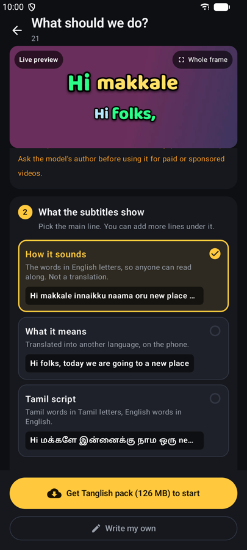
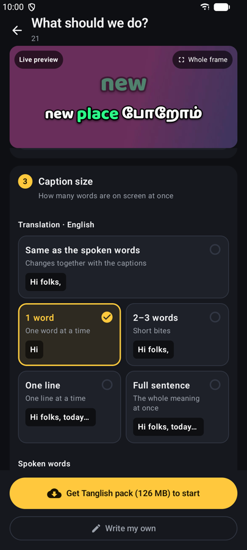
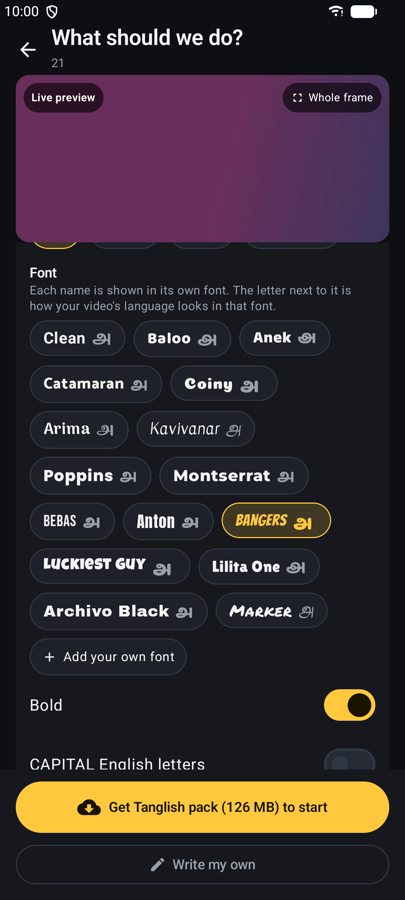
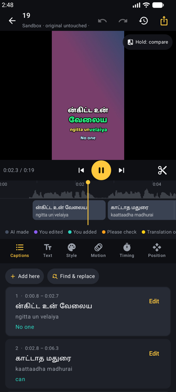
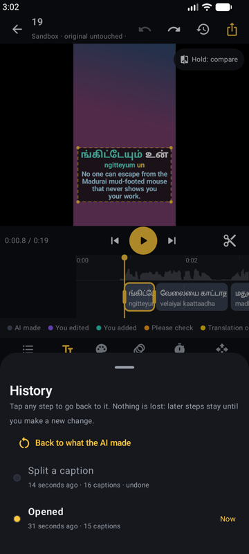
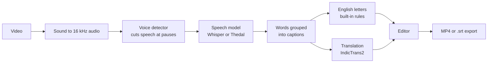

# Offline Reel Captions — Auto Subtitles for Indian Reels, Fully Offline

**An Android app that adds captions to your Reels, Shorts and videos automatically. It listens to what is said and writes it on screen for you. No typing, no internet, no upload.**

Works with **Tamil, Tanglish, Telugu, Kannada, Malayalam, Hindi and English**.

## What it does

You give it a video. It gives you back the same video with captions on it.

1. **Pick a video** from your phone.
2. **Tap Make subtitles.** The app listens to the speech and writes every word, timed to when it is said.
3. **Save.** You get a new MP4 with the captions burned in, ready to post. Or get an `.srt` file to use in any video editor.

The captions can show the words three ways, alone or together:

| Show the words as… | Example |
|---|---|
| **English letters** (how it sounds) | `vanakkam nanbargale` |
| **English meaning** (translation) | `hello friends` |
| **Original script** | `வணக்கம் நண்பர்களே` |

Everything runs on your phone. Your video never leaves it.

## What you can use it for

- **Instagram Reels, YouTube Shorts and TikTok-style videos.** Most people watch with the sound off. Captions keep them watching.
- **Reach people who don't speak your language.** Talk in Tamil and show English letters so anyone can read along, or show the English meaning so anyone can understand.
- **Tanglish talk.** Speak Tamil mixed with English and the English words come out in English, the way you actually talk.
- **Vlogs, recipes, tutorials, interviews and podcast clips.** Get readable captions without typing them by hand.
- **Make your videos accessible** to people who are deaf or hard of hearing.
- **Get a subtitle file** (`.srt`, `.vtt`, `.ass`) for YouTube, Premiere Pro, CapCut or any editor.
- **Private or no-internet use.** Once the language pack is downloaded, it works in airplane mode.

[](https://github.com/R-Dilipkumar/offline-reel-captions/releases/latest)
[](LICENSE)
[](https://github.com/R-Dilipkumar/offline-reel-captions/stargazers)
[](https://developer.android.com)
[](https://developer.android.com/jetpack/compose)
[](https://github.com/k2-fsa/sherpa-onnx)
[](https://github.com/AI4Bharat/IndicTrans2)

<p>
  
  
  
  
  
</p>

## Why this app

Most caption apps send your video to a server, charge per minute, and get Indian languages wrong, or only do Hindi. Offline Reel Captions is different:

- **Made for South Indian creators.** Speech models tuned for Tamil, Telugu, Kannada and Malayalam, plus **Tanglish** (Tamil talk full of English words) where English words come out in English.
- **English letters, by sound.** "Hi makkale vibe pannalaamaa" instead of a translation, so anyone can read along. Casual chat style or exact with accent marks.
- **Fully on the phone.** No account, no upload, no per-minute fees. Works without internet once the language pack is downloaded.
- **Your video is safe.** All edits happen on a copy. Exports are new files.
- **Style it before you make it.** Change the font, colours, motion, size and place right on the first screen. A live preview plays every change, and you can drag and pinch the caption on it.
- **Free and open source** under the MIT license.

If Offline Reel Captions is useful to you, please give it a ⭐ — it helps other creators find it.

## Download

Get the APK from the [latest release](https://github.com/R-Dilipkumar/offline-reel-captions/releases/latest):

| File | For |
|---|---|
| `SubtitleStudio-v0.3.0-arm64-v8a.apk` | Almost every phone from the last 6+ years (about 32 MB) |
| `SubtitleStudio-v0.3.0-universal.apk` | If you are not sure (about 77 MB) |
| `SubtitleStudio-v0.3.0-armeabi-v7a.apk` | Older 32-bit phones |

Open the file on your phone and allow "install unknown apps" when asked. Updating from an older version keeps your projects.

## How to use

1. **Start a project.** Tap **New project** and pick a video.
2. **Spoken language.** Tap the language card and choose what people speak. Each language shows what it is for, how accurate it is and whether its pack is on the phone. Tamil with lots of English words? Choose **Tanglish**.
3. **What the subtitles show.** Pick the main line:
   - **How it sounds** — the words in English letters, not a translation (`vanakkam nanbargale`).
   - **What it means** — a translation into English or another Indian language.
   - **Original script** — the words in தமிழ், తెలుగు, ಕನ್ನಡ, മലയാളം or हिन्दी.

   Then add more lines under it if you like, and pick **Casual** or **Exact** spelling.
4. **Caption size.** 1 word, 2–3 words, one line or a full sentence. The translation has **its own size**: for example Tamil 2–3 words at a time with the English meaning one word at a time, or a whole English line over one-word Tamil captions.
5. **Look.** Pick a ready-made look, then change anything: **Font**, **Colours**, **Motion**, **Size & place**. The live preview at the top plays every change. Tap it for the whole frame, then drag the caption to move it, pinch to resize, twist to turn.
6. **Make subtitles.** The first time, the app asks to download the language pack (on Wi-Fi). Work keeps going if you switch apps.
7. **Fix and style.** Tap any caption to fix a word, its spelling or the translation. Drag captions on the video, retime them on the timeline, change fonts, colours and motion. Already have an `.srt`? Tap **Write my own**, then **Import .srt** in the Captions tab.
8. **Export.** An MP4 with captions burned in, or `.srt`, `.vtt` and `.ass` files.

## Features

- **Auto subtitles, offline** with Whisper models tuned for each Indian language, and a Tanglish model that keeps English words in English.
- **Three lines, any mix:** original script, English letters (phonetic) and a translation. Choose which is the big main line.
- **Translation with its own size.** 1 word, 2–3 words, one line or a full sentence at a time, or changing together with the captions. The meaning of each sentence is shared out by speaking time, so the English keeps pace with the talk.
- **Karaoke-style timing on every line.** The word being spoken can pop, change colour, sweep, get a box, appear word by word or type out letter by letter, on the translation line too.
- **Motion:** pop, bounce, slide, zoom, drop, wipe and fade, with separate in and out speeds, and a per-word entrance.
- **See every edit.** Captions are colour-coded: *AI made*, *You edited*, *You added*, *Please check* (words the AI likely got wrong) and *Translation out of date*. Hold **Compare** to see what the AI made. **History** lists every change; tap any step to go back.
- **Edit everything:** fix words, teach the app a spelling once ("Always spell this word this way"), split and join captions, find and replace, shift all captions, rebuild captions by size, drag/pinch/twist captions with Reels/Shorts/TikTok safe zones.
- **Edit outside the app:** get an `.srt` to fix on a computer, then load it back. Your looks and positions stay. Or **Import .srt** to bring in captions from anywhere.
- **10 ready-made looks** and 16 fonts. Every English-only display font (Bangers, Anton, Luckiest Guy…) comes with a matching Tamil look (Coiny, Catamaran, Kavivanar), so the Tamil and Tanglish lines change font too. In a mixed line, English words keep the English font. Plus your own `.ttf`.
- **Export:** MP4 with burned-in captions (exactly as the preview), or `.srt`, `.vtt` and `.ass` (ASS keeps colours, position and karaoke timing).

## Language packs

Packs download once inside the app (Language packs screen), or can be copied to the phone and added with **Import files** if you have no internet.

| Pack | Size | Accuracy |
|---|---|---|
| Tamil speech (Whisper small, IIT Madras) | 375 MB | Good |
| Tanglish speech (Thedal AED, Tamil + English) | 126 MB | Good |
| Malayalam speech (Whisper small, Kavya Manohar) | 375 MB | Good |
| Hindi speech (Whisper small, IIT Madras) | 375 MB | Good |
| Telugu speech (Whisper tiny, IIT Madras) | 103 MB | Basic |
| Kannada speech (Whisper tiny, IIT Madras) | 103 MB | Basic |
| English speech (Whisper base) | 160 MB | Good |
| Translate to English (IndicTrans2) | 241 MB | Good |
| Translate from English (IndicTrans2) | 289 MB | Good |

English letters (phonetic) need no pack: they are built into the app.

## How it works



- The sound is pulled out with the phone's own decoders. Silero VAD finds speech and cuts it at pauses.
- Each piece goes to the speech model via [sherpa-onnx](https://github.com/k2-fsa/sherpa-onnx) (Whisper) or ONNX Runtime (Thedal, for Tanglish).
- Words are grouped into captions of the size you chose, never across a pause or a sentence end.
- The English-letters line comes from a built-in rule engine for each script, including sound changes the letters don't show (Tamil க is "k" in *kaadhal* but "g" in *magan*). Common English words said in Tamil are spelled the English way.
- Translation runs sentence by sentence with IndicTrans2 on ONNX Runtime. Each sentence's meaning is shared out over its captions by speaking time, then cut again to the translation's own size, so the meaning line can change faster or slower than the words line.
- The editor preview and the export use the same caption drawing code; export uses Media3 Transformer on the phone's video hardware.

## Good to know

- **The AI makes mistakes**, more with fast, slangy or noisy speech. Words that look wrong by spelling rules are marked *Please check*. Telugu and Kannada use smaller models for now, so expect more fixes there.
- **Tanglish model licence:** free for personal, non-commercial use only. Ask the model's author before using it for paid or sponsored videos.
- Making subtitles takes a few times the video's length on most phones.
- Translating between two Indian languages goes through English, so it needs both translation packs.
- Word order differs between languages, so short translation pieces follow the speaking pace, not each word's exact meaning. For the clearest meaning, pick "One line" or "Full sentence" for the translation.
- Undo history covers the current editing session; your latest captions are always saved.
- Needs Android 10 or newer.

## Build from source

Needs JDK 17 and the Android SDK (platform 36).

```bash
git clone https://github.com/R-Dilipkumar/offline-reel-captions.git
cd offline-reel-captions
./gradlew :app:testDebugUnitTest :app:assembleDebug
```

The first build downloads the sherpa-onnx library (about 39 MB) into `app/libs/`. For a signed release build, create `keystore.properties` next to `settings.gradle.kts`:

```properties
storeFile=your-release-key.jks
storePassword=...
keyAlias=...
keyPassword=...
```

then run `./gradlew :app:assembleRelease`. APKs land in `app/build/outputs/apk/`.

## Contributing

Bug reports, wrong spellings in English letters and pull requests are welcome. Please run `./gradlew :app:testDebugUnitTest` before opening a pull request.

## Credits

- Speech: [OpenAI Whisper](https://github.com/openai/whisper) fine-tunes by [vasista22 (IIT Madras Speech Lab)](https://huggingface.co/vasista22) and [Kavya Manohar](https://huggingface.co/kavyamanohar), packed by [ippocode](https://huggingface.co/ippocode/indic-asr-onnx); Tanglish model [Thedal AED by Badri0510](https://huggingface.co/Badri0510/Thedal-AED-Tamil-Tanglish-English-INT4-ConvINT8-ONNX); runtime [sherpa-onnx](https://github.com/k2-fsa/sherpa-onnx) (Apache-2.0); voice detector [Silero VAD](https://github.com/snakers4/silero-vad) (MIT).
- Translation: [AI4Bharat IndicTrans2](https://github.com/AI4Bharat/IndicTrans2) (MIT), ONNX by [Hari31416](https://huggingface.co/hari31416); runtime [ONNX Runtime](https://onnxruntime.ai) (MIT).
- Fonts from Google Fonts: Baloo 2, Anek, Catamaran, Coiny, Arima, Kavivanar, Poppins, Montserrat, Bebas Neue, Anton, Bangers, Lilita One, Archivo Black (SIL Open Font License); Luckiest Guy, Permanent Marker (Apache-2.0). See `app/src/main/assets/fonts/NOTICE.txt`.

## License

The code is released under the [MIT License](LICENSE) © 2026 Dilipkumar R. Downloaded models keep their own licences (MIT, Apache-2.0, and the Tanglish model's non-commercial licence, listed above).
