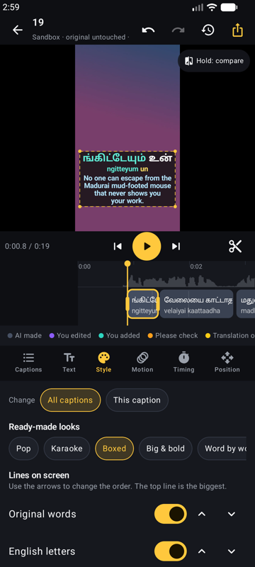

# Subtitle Studio

**Automatic subtitles for Tamil, Telugu, Kannada, Malayalam, Hindi and English videos — with English-letters (phonetic) lines and translation — made fully offline on your Android phone.**

[](https://github.com/R-Dilipkumar/indic-subtitle-studio/releases/latest)
[](LICENSE)


<p>
  
  
  
  
</p>

## Features

- **Auto subtitles, offline.** Speech-to-text runs on the phone with Whisper models tuned for each Indian language. No upload, no account, no internet needed after setup.
- **Three lines, any mix:**
  - the words in their own script (தமிழ், తెలుగు, ಕನ್ನಡ, മലയാളം, हिन्दी),
  - the same words **in English letters, by sound** — chat style (`vanakkam nanbargale`) or exact with accent marks (`vaṇakkam naṇparkaḷē`),
  - a **translation** (Indian languages ↔ English, offline with AI4Bharat IndicTrans2).
- **Karaoke-style timing.** The word being spoken can pop, change colour, sweep, get a box, or appear one by one.
- **A safe sandbox.** Your video is copied into the app. Every edit happens on the copy; exports are new files. Your original is never touched.
- **See every edit.** Captions are colour-coded on the timeline and list: *AI made*, *You edited*, *You added*, *Please check* (words the AI likely got wrong) and *Translation out of date*. Hold **Compare** to see what the AI made. **History** lists every change; tap any step to go back. Full undo/redo.
- **Edit everything:**
  - fix any word, its English-letters spelling, or the translation,
  - teach the app a spelling once ("Always spell this word this way"),
  - split and join captions, add new ones, find and replace,
  - drag caption edges on the timeline to retime, nudge words, shift all captions earlier/later,
  - rebuild captions as 1 word / 2–3 words / one line / full sentence,
  - drag, pinch and twist captions on the video, with centre snapping and Reels/Shorts/TikTok safe zones,
  - 8 ready-made looks, fonts with matching Indian-script designs (Baloo, Anek), your own `.ttf`, colours, outline, shadow, boxes, motion,
  - change one caption or all of them.
- **Export:** an MP4 with the captions burned in (exactly as in the preview), or `.srt`, `.vtt` and `.ass` files (ASS keeps colours, position and karaoke timing).

## Download

Get the APK from the [latest release](https://github.com/R-Dilipkumar/indic-subtitle-studio/releases/latest):

- `app-arm64-v8a-release.apk` — almost every phone from the last 6+ years (about 31 MB)
- `app-universal-release.apk` — if you are not sure (about 76 MB)

Open the file on your phone and allow "install unknown apps" when asked.

## Setup

1. Open the app and tap **Language packs**.
2. Download the speech pack for your language once (on Wi-Fi), and the translation pack if you want translations.
   No internet at all? Copy the pack's files (or a `.zip` of them) to the phone and use **Import files**.
3. Tap **New project**, pick a video, choose what you want, and tap **Make subtitles**.

| Pack | Size | Quality |
| --- | --- | --- |
| Tamil speech (Whisper small, IIT Madras) | 375 MB | Good |
| Malayalam speech (Whisper small, Kavya Manohar) | 375 MB | Good |
| Hindi speech (Whisper small, IIT Madras) | 375 MB | Good |
| Telugu speech (Whisper tiny, IIT Madras) | 103 MB | Basic |
| Kannada speech (Whisper tiny, IIT Madras) | 103 MB | Basic |
| English speech (Whisper base) | 160 MB | Good |
| Translate to English (IndicTrans2) | 241 MB | Good |
| Translate from English (IndicTrans2) | 289 MB | Good |

English letters (phonetic) need no pack: they are built into the app.

## How it works

1. The sound is pulled out of the video with the phone's own decoders and turned into 16 kHz audio.
2. A voice detector (Silero) finds where people speak and cuts the speech at pauses into sentence-sized pieces.
3. Whisper (via [sherpa-onnx](https://github.com/k2-fsa/sherpa-onnx)) writes each piece. Words are timed across the speaking parts by how long each takes to say.
4. Words are grouped into captions of the size you chose, never across a pause or a sentence end.
5. The English-letters line is made by a built-in rule engine for each script, including the sound changes the letters do not show (Tamil க is "k" in *kaadhal* but "g" in *magan*; Hindi कमल is *kamal*, not *kamala*).
6. Translation runs sentence by sentence with IndicTrans2 on ONNX Runtime.
7. The editor preview and the video export use the same caption drawing code, and export uses Media3 Transformer on the phone's video hardware.

## Good to know

- **The AI makes mistakes**, more with fast, slangy or noisy speech. Words that look wrong by spelling rules are marked *Please check*. Telugu and Kannada use smaller models for now, so expect more fixes there.
- Making subtitles takes a few times the video's length (in testing, a 20-second clip took about a minute). Keep the app open while it works.
- History (undo) covers the current editing session; your latest captions are always saved.
- Translating between two Indian languages goes through English, so it needs both translation packs.
- The phone needs Android 10 or newer.

## Build from source

Needs JDK 17 and the Android SDK (platform 36).

```bash
git clone https://github.com/R-Dilipkumar/indic-subtitle-studio.git
cd indic-subtitle-studio
./gradlew :app:testDebugUnitTest :app:assembleDebug
```

The first build downloads the sherpa-onnx library (about 39 MB) from its GitHub release into `app/libs/`.
For a signed release build, create `keystore.properties` next to `settings.gradle.kts`:

```properties
storeFile=your-release-key.jks
storePassword=...
keyAlias=...
keyPassword=...
```

then run `./gradlew :app:assembleRelease`. APKs land in `app/build/outputs/apk/`.

## Credits

- Speech: [OpenAI Whisper](https://github.com/openai/whisper) fine-tunes by [vasista22 (IIT Madras Speech Lab)](https://huggingface.co/vasista22) and [Kavya Manohar](https://huggingface.co/kavyamanohar), packed by [ippocode](https://huggingface.co/ippocode/indic-asr-onnx); runtime [sherpa-onnx](https://github.com/k2-fsa/sherpa-onnx) (Apache-2.0); voice detector [Silero VAD](https://github.com/snakers4/silero-vad) (MIT).
- Translation: [AI4Bharat IndicTrans2](https://github.com/AI4Bharat/IndicTrans2) (MIT), ONNX by [Hari31416](https://huggingface.co/hari31416); runtime [ONNX Runtime](https://onnxruntime.ai) (MIT).
- Fonts: Baloo 2 family, Anek, Poppins, Montserrat, Bebas Neue from Google Fonts (SIL Open Font License).

## License

MIT © 2026 Dilipkumar R. See [LICENSE](LICENSE). Downloaded models keep their own licences (Apache-2.0 and MIT, listed above).
